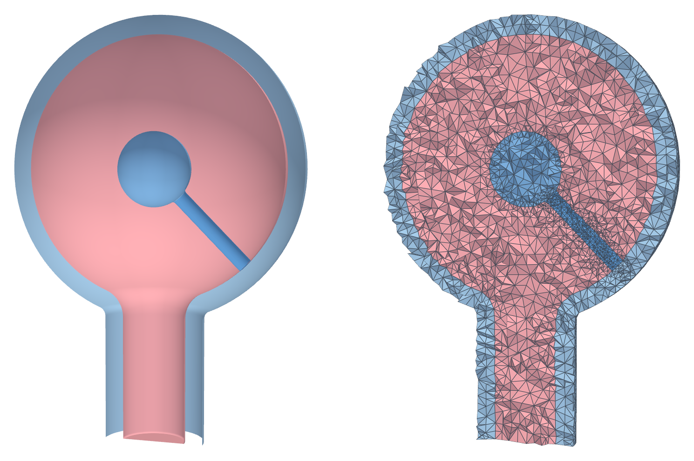

# Idealized Brain Meshing

Command-line tools for generating tagged, idealized multi-domain 3D brain meshes for Biot-Stokes-type simulations in FEniCSx.
The geometry is based on the one used in Chapter 4 of [*Mathematical Modelling of the Human Brain II: From Glymphatics to Deep Learning*](https://doi.org/10.1007/978-3-032-00679-0).

<p align="center"></p>
<p align="center">Example surface geometries (left) and mesh (right).</p>

## Setup
```bash
conda env create -f environment.yml
conda activate fenicsxmesh
```

## Usage
`pipeline.py` runs the whole workflow: surface generation, volume meshing with fTetWild, fixing overconstrained cells, optional uniform refinement, and mesh checks.

```bash
python pipeline.py --name idealizedsas5mm --sas-thickness-mm 5 --sas-cells-across 3
```
This writes the STLs to `surfaces/idealizedsas5mm/` and the mesh to `meshes/idealizedsas5mm/idealizedsas5mm.xdmf`. With `--levels N`, the mesh is also refined uniformly N times, giving `meshes/idealizedsas5mmRef0/`, `meshes/idealizedsas5mmRef1/`, etc.

Run `python pipeline.py --help` for all options.

An example is included in `example/`: the surfaces and corase base mesh (22k cells) for a 10 mm SAS.

### Geometry
The geometry consists of three closed surfaces: skull with spinal canal, parenchyma with spinal cord, and ventricle with aqueduct. Each is a sphere with a tube, joined by a circular fillet. The SAS thickness is set with `--sas-thickness-mm`, and the spinal canal has the same CSF gap.

### Resolution
fTetWild meshes with a sizing field:
- **SAS** (cranial and spinal): edge length `sas-thickness-mm / sas-cells-across`.
- **Aqueduct:** edge length `--aqueduct-edge-mm`.
- **Elsewhere:** edges grow away from these regions by `--grading` per unit distance, up to `--coarse-edge-mm`.

`--epsilon` sets how far the mesh surfaces may deviate from the input geometry, relative to the bounding box diagonal (about 0.3 m). Keep it small compared with the surface cell size, or the surfaces become visibly uneven. The default, 0.0005, suits SAS edges of 1–2 mm; 0.002 suits coarse meshes with about 10 mm edges.

### Example meshes
```bash
# ~0.95M cells
python pipeline.py --name idealizedsas5mm --sas-thickness-mm 5 --sas-cells-across 3 \
    --aqueduct-edge-mm 3 --coarse-edge-mm 12 --grading 1.0

# ~0.9M cells
python pipeline.py --name idealizedsas2mm --sas-thickness-mm 2 --sas-cells-across 1.5 \
    --aqueduct-edge-mm 3 --coarse-edge-mm 12 --grading 1.0

# ~1.1M cells
python pipeline.py --name idealizedsas1mm --sas-thickness-mm 1 --sas-cells-across 1 \
    --aqueduct-edge-mm 3 --coarse-edge-mm 12 --grading 1.0

# Convergence series: 22k, 180k and 1.4M cells
python pipeline.py --name idealizedsas10mm --sas-thickness-mm 10 --sas-cells-across 1 \
    --aqueduct-edge-mm 5 --coarse-edge-mm 12 --grading 1.0 --epsilon 0.002 --levels 2
```

## Individual tools
The pipeline steps can also be run separately:

```bash
python generateMesh.py surfaces --output-dir surfaces/mymesh --sas-thickness-mm 5
python generateMesh.py mesh --stl-dir surfaces/mymesh --name mymesh --sas-edge-mm 1.7
python fixOverconstrainedCells.py meshes/mymesh/mymesh.xdmf -o meshes/mymesh/mymesh.xdmf
python refineMesh.py --input-dir meshes/mymesh --levels 2
python checkMesh.py check meshes/mymesh
```

- **`generateMesh.py`:** `surfaces` writes the STLs (add `--show` to preview them), and `mesh` creates and tags the volume mesh.
- **`fixOverconstrainedCells.py`:** splits cells with three or more faces on the boundary. Run it before `refineMesh.py`, since refinement multiplies these cells.
- **`refineMesh.py`:** refines uniformly and transfers all tags to `<name>Ref1`, `<name>Ref2`, etc.
- **`checkMesh.py`:** reports cell quality, overconstrained cells and missing tags.

## Mesh tags
Each `.xdmf` file contains two cell tags and two facet tags.

**`subdomains`**
| ID | Domain |
| :--- | :--- |
| 1 | Porous: parenchyma |
| 2 | Fluid: SAS and ventricles |

**`subdomains_ftetwild`**
| ID | Domain |
| :--- | :--- |
| 1 | SAS |
| 2 | Parenchyma |
| 3 | Lateral and third ventricles (sphere) |
| 4 | Aqueduct and fourth ventricle (tube) |

**`boundaries`** and **`boundaries_split`**
| ID | Description | In |
| :--- | :--- | :--- |
| 1 | Tissue-CSF interface | `boundaries` |
| 2 | Skull | both |
| 3 | Spinal canal outlet | both |
| 4 | Spinal cord outlet | both |
| 11 | Pia | `boundaries_split` |
| 12 | Ependyma | `boundaries_split` |
| 13 | SAS-ventricle connection | `boundaries_split` |

Reading a mesh in FEniCSx:
```python
import dolfinx
from mpi4py import MPI

with dolfinx.io.XDMFFile(MPI.COMM_WORLD, "example/idealizedsas10mmRef0.xdmf", "r") as xdmf:
    domain = xdmf.read_mesh()
    subdomains = xdmf.read_meshtags(domain, name="subdomains")
    subdomains_ftetwild = xdmf.read_meshtags(domain, name="subdomains_ftetwild")
    # Facet tags need facet-to-cell connectivity
    domain.topology.create_connectivity(domain.topology.dim - 1, domain.topology.dim)
    boundaries = xdmf.read_meshtags(domain, name="boundaries")
    boundaries_split = xdmf.read_meshtags(domain, name="boundaries_split")
```
